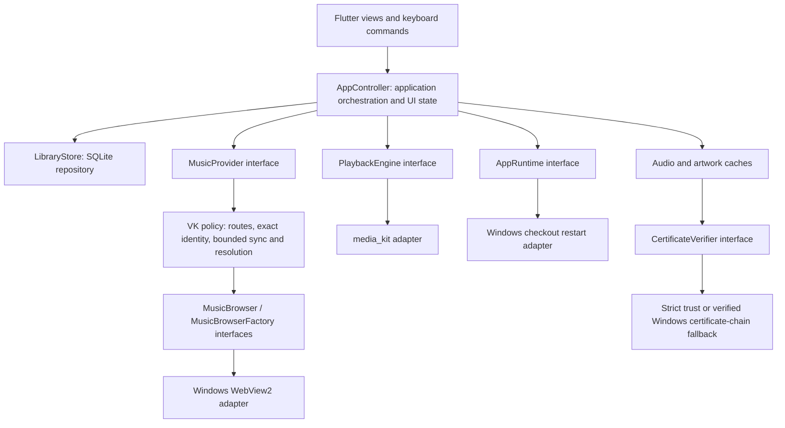

# Ownsemble architecture

The user selected this rework on 2026-10-22, before more features or a full port.
This document describes implemented boundaries, not a promise that every target
OS already has a tested release. See [the decision](decisions/0001-platform-boundaries.md)
and [platform acceptance](PLATFORM_PORTABILITY.md).

## Responsibilities and dependency direction

`bootstrap/application.dart` chooses and connects concrete implementations.
Dependencies are passed through constructors; there is no global service locator
or extra dependency-injection framework. Views do not construct providers, browse
pages, choose browser engines, execute native input or open media themselves.

- `contracts/` defines application and platform boundaries using application-owned
  types. Browser controllers, WebUri, DevTools maps and native Player instances
  never cross those interfaces. Certificate fallback uses Dart's X509Certificate,
  keeping ordinary HttpClient TLS verification enabled.
- `provider/vk_provider.dart` owns VK policy and sequencing. Its entire dependency
  graph is pure Dart: no Flutter assets, native IO, browser package or OS checks.
  A supplied asset loader installs the same guarded JS adapter. Routes, personal
  library/form guards, exact recording witnesses and cancellation stay shared.
- `platform/windows/` owns the existing patched WebView2 implementation, private
  environment, native input/focus/mute, resource observation, Windows certificate
  verification and checkout-executable selection/restart. Platform adapters own
  raw native responses; request events expose only URI and bounded request type,
  never headers, cookies, authentication responses or bodies.
- `platform/media_kit_*` owns native playback, stream/local opening, full decoding
  and native clock checks. Application/UI use snapshots/events and typed commands,
  including typed pause/clock diagnostics rather than arbitrary native properties.
- `media/` owns transport/cache, streaming and validation policy. TLS fallback is
  injected; strict rejection is the default. Windows bootstrap explicitly supplies
  the existing SSL-policy verifier. Artwork destination policy is pure Dart and
  separate from IO/image decoding so it cannot pull Flutter into VK policy.
- `LibraryStore` remains the concrete SQLite repository and data source of truth.
  The existing queue is a separate pure-Dart component. Keeping a working concrete
  local repository is intentional; do not add generic repository/base-class layers
  without an actual second implementation or a concrete behavioral need.

Small exports at the old native-helper locations preserve isolated probes/tests.
They contain no duplicate implementation. Shared production policy cannot import
those compatibility paths; the dependency tests enforce this.

## Ownership and asynchronous work

The composition root creates one provider, playback engine and controller per app.
The provider receives one private browser factory; independent scanner, playback
and metadata documents share its dedicated session environment, not a renderer.
Only the application may use that environment internally. No agent/helper profile
inspection, cookie extraction, credentials API or account mutation is introduced.

Factory capability checks reject unsupported backends before environment/page
access. Every backend must provide private session lifecycle, hidden documents,
request observation, trusted input, native audio isolation before navigation and
document-start scripts. Runtime mute verification is still mandatory. A backend
must prove these properties with generated native probes before claiming support;
a capability declaration alone does not establish safety or provider reliability.

Each connection has a generation. Disconnect invalidates callbacks and pending
creation; old callbacks cannot change a new connection. Failed opening and failed
mute verification close the renderer; retry creates a new one. Input rechecks the
music/recording witness at each event. Stop disposes playback documents without
scrolling or closing the independent scanner. Existing bounded metadata/artwork
queues and audio priority are preserved.

Controller shutdown cancels work/subscriptions and disposes owned resources.
Checkout restart is an optional injected runtime operation. Shared orchestration
receives only a boolean enabling fixed local controls, not an executable or a
private browser profile path. Unsupported restart/browser capabilities fail
explicitly; adapters must never emulate trusted input with untrusted DOM clicks,
replace native muting with DOM-only muting, or relax identity/TLS checks to pass.

## Extending the app

For a new OS, implement/prove browser and lifecycle capabilities under `platform/`,
reuse shared policy/storage/cache/queue, then wire the adapter in the composition
root. Reuse the native media adapter only after its target-specific tests pass.
Do not put an OS branch or plugin import back into provider/application policy.

For a new source, implement the provider contract and its identity/destination
policy. The current stored IDs, reference fields and approved audio destinations
still reflect the VK-first catalog; this rework does not pretend that YouTube or
local files already fit without additive provenance/identity work. Test a stable
multi-source identity/migration contract before importing another source. Never
silently substitute a similarly named recording or mutate existing IDs.

Schema, receipts, digest markers and saved files were not migrated or rewritten.
Existing absolute cache paths remain supported on Windows. Cross-device/cache
relocation needs a separate tested migration: shared schema/algorithms do not make
Windows paths usable on Linux/Android. Background audio, notification controls,
permissions and platform packaging also require separate target acceptance.

AppController still coordinates several use cases; it is not declared a finished
universal architecture. Extract focused services when their behavioral contracts
and independent responsibilities justify it, while preserving the ports. This
milestone removes platform/plugin construction and native operations from that
controller rather than splitting its state into many coupled forwarding classes.

## Evidence and continuing rules

Architecture fitness tests first failed for direct dependencies, then for hidden
transitive artwork/Flutter dependencies and Windows TLS selection in caches.
Browser regressions were observed failing before their respective fixes: mute API
failure cleanup, cancellation before creation, stale callbacks and open-failure
retry. Additional positive boundary/playback tests are supplemental acceptance.
See the latest handoff and `.local/ownsemble/architecture-*` sanitized reports.

The same generated provider-policy probe runs with standalone Dart on Windows and
Linux (WSL), without Flutter or a native browser. The generated native browser smoke
now uses the new MusicBrowser interface/Windows adapter itself. Those are different
gates: passing the former does not prove the latter on Linux or real VK anywhere.
Existing full Flutter, JS adapter, native playback/restart/retention, streaming and
scoped main-player checks remain required for Windows release acceptance.

Linux native UI continuation: `app/linux/` now provides a standard GTK host and
shared-shutdown bridge. Generated UI/audio/cache/restart checks pass in WSLg; see
LINUX_PROOF.md. This adds no WSL-only application dependency. Linux live VK and
ordinary-desktop/other-distribution acceptance remain pending.

Linux browser continuation: bootstrap/browser_factory.dart now selects the native
CEF adapter under platform/linux. The child helper lives in linux/browser and
ships under lib/ownsemble_browser with a pinned verified engine. JSON pipes expose
only the application contract, no network debug listener/cookie export. Linux and
Windows session namespaces are distinct. See LINUX_BROWSER_ADAPTER.md for native
acceptance, packaging, security-update duties and remaining live/distro gates.
